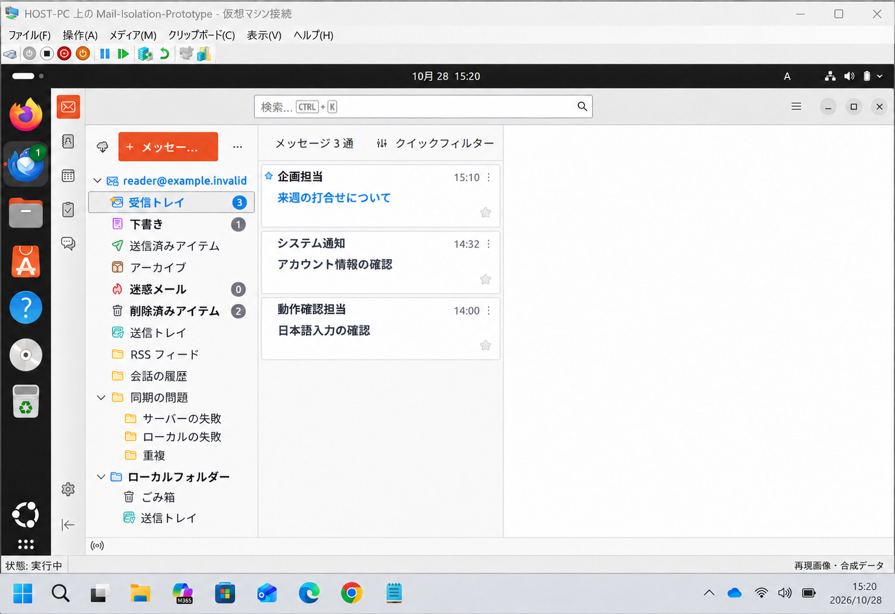
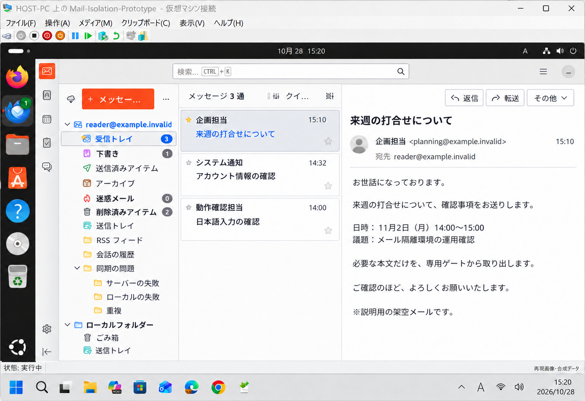

# Mail Isolation Prototype

A prototype that runs Ubuntu in Hyper-V on Windows, separating the email environment from the everyday workspace.

The aim is to define where email is handled and what information can be brought into the workspace, without relying on users to recognize every convincing phishing message before opening it.

## Overview

```text
Email service
    |
Hyper-V on Windows
    +-- Ubuntu / Thunderbird
          +-- Extract the selected message body
                    | Dedicated body-transfer channel
Windows / Text Only Gate
    +-- Plain-text display -> User review -> Save a new UTF-8 .txt file
```

Original messages are viewed inside Ubuntu. The export workflow transfers the extracted body text, leaving attachments, images, and original message files in the guest environment.

The Windows application validates incoming data and displays it as plain text without interpreting HTML. It modifies URL-like notation to avoid directly opening external destinations from links. Saving requires an explicit user action and creates a new `.txt` file.

## Environment

- Host: Windows / Hyper-V
- Guest: Ubuntu Desktop
- Email client: Thunderbird for Ubuntu
- Email account: Microsoft Exchange
- Body export: A guest-side extraction application and Text Only Gate on Windows

On the physical installation, the operator has confirmed access to the same messages as in Outlook, Japanese text input, body transfer, and saving as UTF-8 text.

## Workflow

1. Start the email Ubuntu virtual machine in Hyper-V.
2. Read email in Thunderbird inside Ubuntu.
3. Save the selected message as an `.eml` file inside Ubuntu when its body is needed in the workspace.
4. Select the message in the body extraction application, review the extracted text, and transfer it.
5. Review the text in Text Only Gate on Windows and save a UTF-8 `.txt` file if needed.

Verify requests and instructions in email through the appropriate business process. Payments, credential entry, and changes to transaction details should follow the organization's established verification procedures.

## Screens





These are reconstructed illustrations based on the actual interface. Account details, messages, and counts are fictional. They are not unmodified screenshots of the installation. The Japanese interface reflects the environment used for this project.

## About this repository

This repository introduces the concept, architecture, and workflow of the email isolation environment. The publication contains no actual email, credentials, or deployment-specific settings.

This is a description of a prototype, not a product security certification or a guarantee for other deployments.

See [Usage](usage.md) for the workflow and [Architecture and data flow](architecture.md) for the design.

